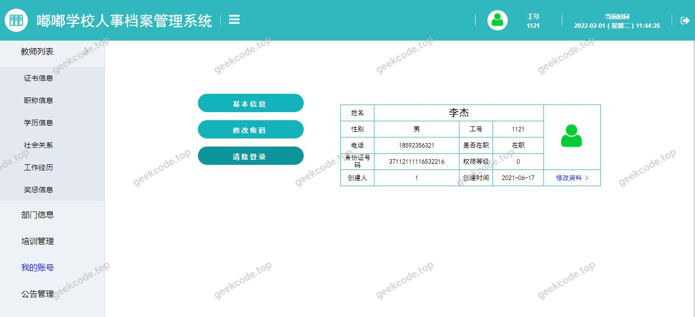
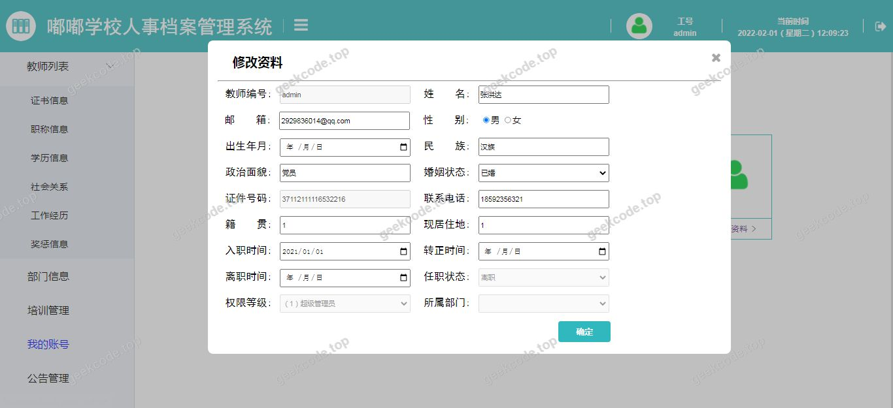
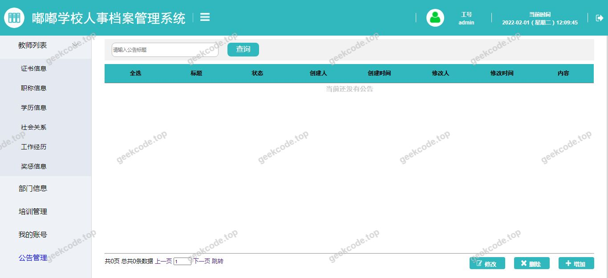

# java精品项目-基于ssm的校园人力资源管理系统

> 🎓 **计算机毕业设计 · java精品项目-基于ssm的校园人力资源管理系统**
>
> 本仓库只放**项目介绍 + 运行截图**（截图是站点带水印的原图，存在仓库 `images/` 里）。
>
> 👉 **完整可运行源码 / 数据库脚本 / 部署文档：[点我获取](https://geekcode.top/archives/java%E7%B2%BE%E5%93%81%E9%A1%B9%E7%9B%AE-%E5%9F%BA%E4%BA%8Essm%E7%9A%84%E6%A0%A1%E5%9B%AD%E4%BA%BA%E5%8A%9B%E8%B5%84%E6%BA%90%E7%AE%A1%E7%90%86%E7%B3%BB%E7%BB%9F?utm_source=github)**
>
> 💬 咨询微信：**ir9372**　|　🌐 更多项目：[极客代码 geekcode.top](https://geekcode.top/?utm_source=github)
>
> 📌 项目详情页：<https://geekcode.top/archives/java%E7%B2%BE%E5%93%81%E9%A1%B9%E7%9B%AE-%E5%9F%BA%E4%BA%8Essm%E7%9A%84%E6%A0%A1%E5%9B%AD%E4%BA%BA%E5%8A%9B%E8%B5%84%E6%BA%90%E7%AE%A1%E7%90%86%E7%B3%BB%E7%BB%9F?utm_source=github>

<table><td width="230" align="center"> <b>扫码加微信 ir9372</b></td><td valign="middle">📦 源码 = 项目介绍 + 全部运行截图 + 数据库 + 部署文档 👉 点上方任意截图，直接跳到 <b>极客代码 geekcode.top</b> 详情页</td></table>

---

<h1>java精品项目-基于ssm的校园人力资源管理系统</h1>
<h2>项目概述</h2>

本项目名为“java精品项目-基于ssm的校园人力资源管理系统”，旨在为高校环境提供一套轻量级、高效的人力资源管理解决方案。系统采用经典的SSM（Spring + Spring MVC + MyBatis）架构理念，结合Spring Boot框架进行快速构建与部署，通过JSP技术实现前端页面渲染。核心目标在于简化校园内人员信息的录入、存储与维护流程，提升行政办公效率。适用场景主要面向高校内部管理部门或小型教育机构的人员档案数字化管理需求。由于该项目定位为纯后端逻辑支撑配合JSP视图展示的传统Web应用，未包含独立的前台用户交互界面及复杂的后台路由配置，其核心价值在于稳定可靠的数据持久层与服务层设计，以及通过WebSocket实现的潜在实时通信能力基础。

<h2>技术架构</h2>

本系统采用分层架构设计，严格遵循MVC设计模式，确保业务逻辑、数据访问与视图展示的分离。

<strong>后端架构：</strong>
核心框架选用Spring Boot作为启动器，利用其自动配置特性简化开发流程。持久层采用MyBatis框架，通过<code>mybatis-spring-boot-starter</code>集成，实现对MySQL数据库的高效操作。同时引入<code>spring-boot-starter-data-jpa</code>以支持标准ORM映射，增强数据模型的规范性。服务层基于Spring生态体系，处理业务逻辑事务。

<strong>前端架构：</strong>
视图层采用JSP（Java Server Pages）技术，配合JSTL标签库和Standard库进行页面动态渲染。使用Tomcat嵌入式容器（<code>tomcat-embed-jasper</code>）直接运行JSP页面，无需单独部署外部Web服务器，实现了前后端一体化的传统Web应用部署模式。

<strong>通信机制：</strong>
集成<code>spring-boot-starter-websocket</code>，为系统提供了双向实时通信的基础能力，可用于后续扩展消息通知或状态同步功能。

<strong>数据库设计要点：</strong>
数据存储于MySQL关系型数据库中，通过<code>mysql-connector-java</code>驱动连接。表结构设计需满足第三范式，重点保障人员信息数据的完整性与一致性，支持高效的增删改查操作。

<h2>功能模块</h2>

根据现有源码配置与截图信息，该系统的功能模块主要集中在基础的业务数据处理与系统运行展示上，具体划分如下：

<strong>1. 核心业务处理模块</strong>

<ul>
<li><strong>数据持久化管理</strong>：基于MyBatis和JPA实现人力资源相关实体对象的数据库存取操作，包括人员基本信息的创建、更新、删除及查询功能。</li>
<li><strong>业务逻辑服务</strong>：通过Spring Service层封装具体的校园人力资源管理规则，如员工入职、离职、部门调动等业务逻辑的处理。</li>
</ul>

<strong>2. 视图展示模块</strong>

<ul>
<li><strong>JSP页面渲染</strong>：负责将后端处理后的模型数据转换为HTML页面呈现给用户。截图显示的系统运行界面即为JSP渲染后的最终效果，展示了数据列表或表单输入等基础UI元素。</li>
<li><strong>静态资源加载</strong>：通过内置Tomcat容器加载CSS、JS等前端静态资源，保证页面的样式与交互脚本正常运行。</li>
</ul>

<strong>3. 实时通信基础模块</strong>

<ul>
<li><strong>WebSocket连接管理</strong>：虽然未明确展示具体聊天或推送功能，但依赖项中包含了WebSocket Starter，表明系统具备建立长连接的技术基础，可用于未来扩展实时消息推送功能。</li>
</ul>

<em>(注：根据提供的上下文，项目中无独立的前台导航菜单和个人中心菜单，也无明确的后台路由配置，因此功能模块仅涵盖上述基于代码依赖推断的基础架构功能。)</em>

<h2>用户角色与权限</h2>

根据现有信息，该项目并未在配置文件中定义具体的角色枚举或权限拦截器链，且无前台/后台路由区分。因此，<strong>根据现有信息无法确定</strong>具体的用户角色划分（如管理员、教师、学生等）及其对应的细粒度权限控制策略。

在实际部署中，通常此类SSM/JSP项目可能默认所有访问者均为同一类普通用户，或者通过简单的Session验证来区分登录状态，但未体现复杂的多角色RBAC（基于角色的访问控制）模型。若需实施权限管理，需在后续开发中补充Spring Security或自定义拦截器来实现。

<h2>项目特色与创新点</h2>
<ol>
<li><strong>经典与现代融合的技术栈</strong>：项目巧妙结合了传统的SSM开发模式与现代Spring Boot的快速启动优势。既保留了MyBatis对SQL精细控制的灵活性，又享受了Spring Boot自动配置带来的便捷性，适合教学演示与传统企业级应用的平滑过渡。</li>
<li><strong>一体化部署体验</strong>：通过嵌入Tomcat Jasper引擎直接运行JSP页面，消除了传统WAR包部署到外部Tomcat服务器的繁琐步骤，实现了“开箱即用”的开发与测试体验，降低了环境配置的复杂度。</li>
<li><strong>双ORM支持潜力</strong>：同时引入了MyBatis和Spring Data JPA，使得开发者可以根据不同业务场景灵活选择ORM方案。对于复杂报表查询可使用MyBatis原生SQL，而对于简单CRUD则可使用JPA的方法名推导，提升了开发效率。</li>
<li><strong>实时通信基础设施预留</strong>：集成WebSocket依赖，为校园场景中可能需要的即时通知（如会议提醒、任务指派）提供了底层技术支持，具备良好的可扩展性。</li>
</ol>
<h2>部署环境</h2>

为确保系统正常运行，需准备以下软件环境：

<ol>
<li><strong>Java运行环境</strong>：JDK 8 或 JDK 11（推荐版本，需兼容Spring Boot及JSP编译要求）。</li>
<li><strong>数据库系统</strong>：MySQL 5.7 或 MySQL 8.0+。需提前安装并配置好数据库服务，创建相应的Schema。</li>
<li><strong>构建工具</strong>：Maven 3.6+ 或 Gradle（用于管理依赖项 <code>spring-boot-starter-web</code>, <code>mysql-connector-java</code> 等）。</li>
<li><strong>IDE建议</strong>：IntelliJ IDEA 或 Eclipse（需安装JSP支持插件以正确预览页面）。</li>
<li><strong>操作系统</strong>：Windows 10/11, macOS 或 Linux (CentOS/Ubuntu)。</li>
</ol>

<strong>启动方式：</strong>
直接运行主启动类（Application Class），内置Tomcat服务器将在默认端口（通常为8080）启动，浏览器访问相应URL即可看到JSP渲染的系统运行界面。

<h2>五、技术特性</h2>
<ul>
<li>服务端模板渲染（JSP）</li>
</ul>
<h2>六、功能模块截图</h2>
<h3>前台用户端</h3>
<h4>系统运行界面1</h4>

<h4>系统运行界面2</h4>

<h4>系统运行界面3</h4>

<h4>系统运行界面4</h4>

<h4>系统运行界面5</h4>

---

## 获取完整源码

| 项目 | 说明 |
| --- | --- |
| 项目名 | java精品项目-基于ssm的校园人力资源管理系统 |
| 运行截图 | 本文 5 张（站点带水印原图，仓库 `images/` 目录） |
| 完整源码 | [https://geekcode.top/archives/java%E7%B2%BE%E5%93%81%E9%A1%B9%E7%9B%AE-%E5%9F%BA%E4%BA%8Essm%E7%9A%84%E6%A0%A1%E5%9B%AD%E4%BA%BA%E5%8A%9B%E8%B5%84%E6%BA%90%E7%AE%A1%E7%90%86%E7%B3%BB%E7%BB%9F?utm_source=github](https://geekcode.top/archives/java%E7%B2%BE%E5%93%81%E9%A1%B9%E7%9B%AE-%E5%9F%BA%E4%BA%8Essm%E7%9A%84%E6%A0%A1%E5%9B%AD%E4%BA%BA%E5%8A%9B%E8%B5%84%E6%BA%90%E7%AE%A1%E7%90%86%E7%B3%BB%E7%BB%9F?utm_source=github) |
| 咨询微信 | **ir9372**（备注：jingpin-yuanma） |
| 更多项目 | [极客代码 geekcode.top](https://geekcode.top/?utm_source=github) |

> 需要源码、部署、改配置、跑不起来等问题，加微信 ir9372 沟通，说明项目名即可。
